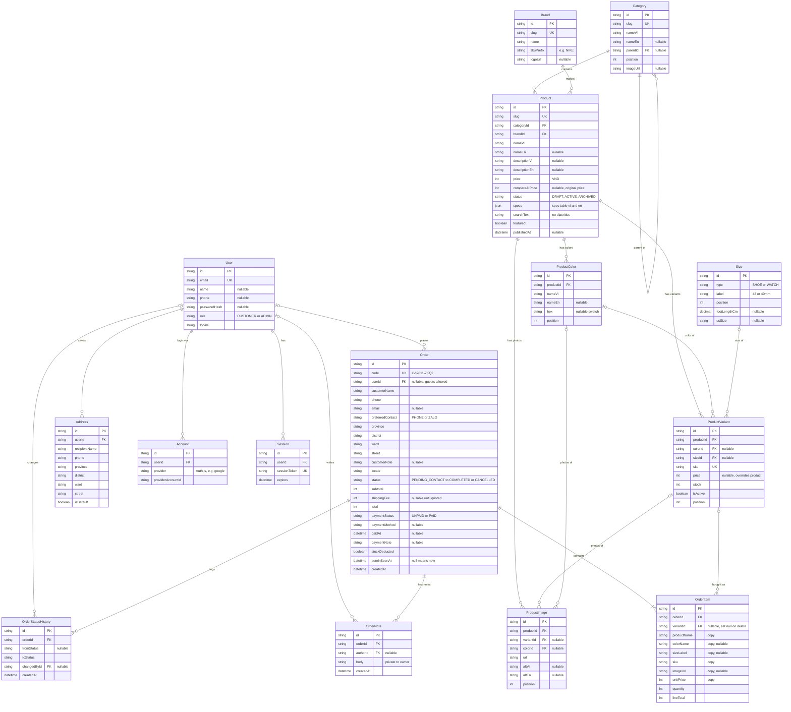

# 001 Database: Table Diagram

All tables for release 1. PK = primary key, FK = foreign key, UK = unique. Lines show relationships (one, zero-or-one, many). Details and rules are in [plan.md](plan.md).

## Groups
| Group | Tables |
|---|---|
| Catalog | Category, Brand, Product, ProductColor, Size, ProductVariant, ProductImage |
| People | User, Address, Account, Session (Auth.js also adds VerificationToken) |
| Orders | Order, OrderItem, OrderStatusHistory, OrderNote |

Every table also has `createdAt` and `updatedAt` unless shown otherwise.
