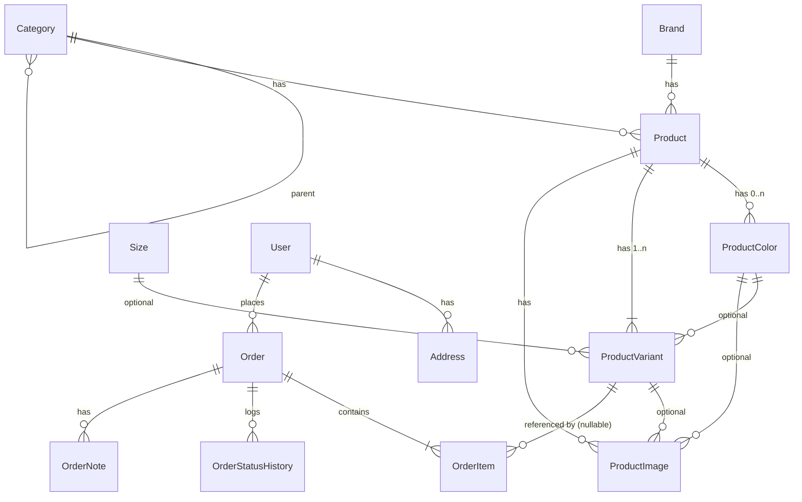

# 001 Database: Plan

Status: **implemented** (tasks 1-8 done, 67 tests passing). Implements [spec.md](spec.md). Nothing in this plan has been built yet.

## Technology
- PostgreSQL with **Prisma 6.19** (`prisma` and `@prisma/client`). Prisma 7 requires Node 22.18+, but this machine runs Node 20.13, so we stay on 6.x. Revisit when Node is upgraded.
- **Local development:** Postgres in Docker (`docker-compose.yml`, a throwaway container with a named volume). Docker is installed here.
- **Production:** a managed Postgres (Neon or Supabase), chosen at launch time. Only `DATABASE_URL` changes.
- Migrations with `prisma migrate`; seed with `prisma/seed.ts`.
- Money: `Int` VND. Timestamps: UTC (`DateTime`).
- Primary keys: `cuid` strings, plus human-friendly `slug` or `code` where needed.

## Entity relationship overview

## Models
Columns marked `?` are optional. All have `id`, `createdAt`, `updatedAt` unless noted.

### Catalog
**Category**: `slug` (unique), `nameVi`, `nameEn?`, `parentId?`, `position`, `imageUrl?`.

**Brand**: `slug` (unique), `name`, `logoUrl?`, `skuPrefix` (short code used when suggesting SKUs, e.g. `NIKE`). Many rows: the shop resells third-party brands, and the owner adds them in admin. Used for the brand filter.

**Product**
- `slug` (unique), `categoryId`, `brandId` (both required)
- `nameVi`, `nameEn?`, `descriptionVi?`, `descriptionEn?`
- `price` (Int, default selling price), `compareAtPrice?` (Int, original price for sale display)
- `status`: `DRAFT | ACTIVE | ARCHIVED`
- `specs` (Json): list of `{ key, labelVi, labelEn?, valueVi, valueEn? }`, validated with Zod
- `searchText` (String): lowercase, no diacritics, built from name, brand, category in code on save
- `featured` (Boolean), `publishedAt?`
- Indexes: `categoryId`, `status`, `brandId`, `searchText` (trigram index added in a raw SQL migration for fast `contains` search)

**ProductColor** (optional per product)
- `productId`, `nameVi`, `nameEn?`, `hex?`, `position`
- Unique: (`productId`, `nameVi`)

**Size** (shared reference list, not per product)
- `type`: `SHOE | WATCH`, `label` (e.g. `42`, `40mm`), `position` (sort order), `footLengthCm?` (Decimal, shoes), `usSize?` (String)
- Unique: (`type`, `label`). Seeded with shoe sizes 36-47 and watch sizes 34mm-46mm; the owner can add more in admin.
- A size cannot be deleted while a variant uses it.

**ProductVariant** (every product has at least one)
- `productId`, `colorId?`, `sizeId?`
- `sku` (unique; suggested as `<brand skuPrefix>-<product code>-<color>-<size>`, editable), `price?` (Int, overrides the product price), `stock` (Int, default 0), `isActive` (Boolean), `position`
- Unique: (`productId`, `colorId`, `sizeId`). PostgreSQL treats NULLs as distinct, so a raw SQL migration adds a unique index using `COALESCE` so that "no color, no size" cannot be duplicated either.
- Delete rule: a product cascades to its colors, variants and images.
- Check (raw SQL): `stock >= 0`, `price >= 0`.

**ProductImage**
- `productId`, `variantId?`, `colorId?`, `url`, `altVi?`, `altEn?`, `position`
- Rule (checked in code and by a DB check): at most one of `variantId` and `colorId` is set. Neither set means a general product photo.
- Resolution when the shopper picks a variant: its own photos, else its color's photos, else the product's general photos.
- Index: (`productId`, `variantId`, `colorId`, `position`)

### Users (Auth.js tables added in the accounts spec, F08)
**User**: `email` (unique), `name?`, `phone?`, `passwordHash?`, `role` (`CUSTOMER | ADMIN`), `locale`.
**Address**: `userId`, `recipientName`, `phone`, `province`, `district`, `ward`, `street`, `isDefault`.
Auth.js `Account`, `Session`, `VerificationToken` follow the Auth.js Prisma adapter.

### Orders
**Order**
- `code` (unique, e.g. `LV-2611-7KQ2`), `userId?`
- `customerName`, `phone`, `email?`, `preferredContact`: `PHONE | ZALO`
- `province`, `district`, `ward`, `street`, `customerNote?`, `locale`
- `status`: `PENDING_CONTACT | CONTACTED | CONFIRMED | SHIPPING | COMPLETED | CANCELLED` (shown in Vietnamese: Chờ liên hệ, Đã liên hệ, Đã xác nhận, Đang giao, Hoàn thành, Đã hủy)
- `subtotal` (Int), `shippingFee?` (Int, empty until confirmed), `total` (Int, subtotal + shipping when known)
- Payment, kept separate from delivery status: `paymentStatus` (`UNPAID | PAID`), `paymentMethod?` (`COD | BANK_TRANSFER | OTHER`), `paidAt?`, `paymentNote?`
- `stockDeducted` (Boolean, guards against restoring or deducting stock twice)
- `adminSeenAt?` (null means the order is new)
- Indexes: `status`, `createdAt`, `phone`, `adminSeenAt`

**OrderItem**: snapshot of what the customer ordered
- `orderId` (cascade), `variantId?` (set null if the variant is deleted)
- `productName`, `colorName?`, `sizeLabel?` (a copy of the size text, not a link), `sku`, `imageUrl?`, `unitPrice` (Int), `quantity` (Int), `lineTotal` (Int)

**OrderStatusHistory**: `orderId`, `fromStatus?`, `toStatus`, `changedById?`, `createdAt`.

**OrderNote**: `orderId`, `authorId?`, `body`, `createdAt` (private, never shown to customers).

## Key behaviors (implemented in application code, covered by tests)
1. **Variant resolution:** a product with no colors and no sizes gets one default variant when created. The UI hides pickers for axes that have a single choice.
2. **Effective price:** `variant.price ?? product.price`.
3. **Order creation (one transaction):** re-read variants, check `isActive`, product `ACTIVE` and that stock covers the quantity (stock is only reduced later, at confirmation), recompute prices from the database (never trust the browser), create the order, items, and the first history row, generate the order code with a retry on collision. The Telegram alert is sent after the transaction commits.
4. **Status change (one transaction):** update the status, write a history row; on first move to `CONFIRMED` deduct stock and set `stockDeducted`; on move to `CANCELLED` with `stockDeducted` restore stock and clear the flag. Stock never goes below zero (conditional update; fails clearly if short).
5. **Search:** normalize the query the same way as `searchText` (lowercase, strip diacritics, `đ` to `d`), then `contains` match.

## Files to create (when approved)
- `prisma/schema.prisma`, `prisma/migrations/*` (including the raw SQL for the unique-with-NULL index, checks, and trigram index), `prisma/seed.ts`
- `docker-compose.yml` (local Postgres), `.env.example` update (`DATABASE_URL`)
- `src/lib/db.ts` (Prisma client singleton)
- `src/lib/search.ts` (`normalizeSearch`) with tests
- `src/lib/orders/` (create order, change status, order code) with tests
- npm scripts: `db:up`, `db:migrate`, `db:seed`, `db:studio`

## Seed data
Four fictional placeholder brands (2 for shoes, 2 for watches, not real companies; the owner adds the real ones in admin) and about 8 fictional products: 4 watches (most with color and case-size variants, one with no options at all) and 4 shoes (color and size variants), with Vietnamese and English text, spec tables, sale prices on two products, and a mix of variant-level, color-level and general photos. Placeholder image URLs until real photos exist.

## Tasks
1. Add Prisma 6.19, Docker compose, `DATABASE_URL`, scripts.
2. Catalog models and first migration.
3. Raw SQL: unique-with-NULL index, check constraints, trigram search index.
4. User, Address, Order, OrderItem, history and notes models and migration.
5. `normalizeSearch` and tests.
6. Seed script.
7. Order creation and status change logic with tests (including stock deduct/restore and snapshot behavior).
8. Verify: run migrations from scratch, seed, run tests, lint, typecheck, build.

## Risks
- **Prisma 6 vs 7:** fine today; plan a later upgrade when Node is 22+.
- **Overselling the last item** between order submit and confirm: acceptable for manual confirmation (the owner contacts the customer first); revisit with online payments in release 2.
- **Auth tables** are finalized in spec F08; the `User` model here is the minimum the order needs and will be extended, not replaced.
